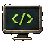
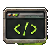
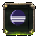

# Hi there , I'm **Carl Matthew T. Castro**

&nbsp;

---

## &nbsp; About Me

| | Field | Details |
|:-:|:--|:--|
|  | **Age** | 22 |
|  | **Currently enrolled at** | Laguna State Polytechnic University – Santa Cruz Campus |
|  | **Program** | Bachelor of Science in Information Technology (BSIT) |
|  | **Passionate about** | Cybersecurity & Software Development |
|  | **Fun fact** | I love playing the guitar and I'm a proud fan of **T1 Esports!** |

---

## &nbsp; Goals

| | Goal |
|:-:|:--|
|  | Aiming to strengthen my expertise in **coding, backend/frontend development, and cross-platform application development** |
|  | Create **impactful projects** that benefit my community |
|  | Gain expertise in **databases (SQL)** and **full-stack development** |

---

## &nbsp; Current Projects

| | Focus |
|:-:|:--|
|  | Developing full-stack web applications using **Laravel**. |
|  | Mastering the **request lifecycle** and client-server architecture. |
|  | Improving **Git** and **GitHub** workflows for source-code management. |
|  | Developing practice projects in Python, C#, and Java. |
|  | Exploring mobile app development with **Flutter** and **Android Studio**. |

---

## &nbsp; Recent Milestones

| | Milestone | Details |
|:-:|:--|:--|
|  | **Laravel Environment** | Successfully configured PHP, Composer, and Laravel, and deployed my first Laravel application. |
|  | **Web Architecture** | Gained a deep understanding of the request lifecycle and how backend frameworks facilitate server-client communication. |
|  | **Version Control** | Strengthened collaborative skills and source-code management practices. |

---

## &nbsp; Languages & Tools

&nbsp;
&nbsp;
&nbsp;
&nbsp;
&nbsp;
&nbsp;

 
&nbsp;
&nbsp;
&nbsp;
&nbsp;
&nbsp;

---

## &nbsp; Skills

| | Category | Stack |
|:-:|:--|:--|
|  | **Web Development** | Laravel, PHP, HTML, CSS, JS |
|  | **Programming** | Python, Java, C# |
|  | **Database & Tools** | MySQL, Git, GitHub |

 

## Socials

&nbsp;&nbsp;
&nbsp;&nbsp;
&nbsp;&nbsp;
&nbsp;&nbsp;

---

*✨ Always eager to explore and learn new technologies ✨*

