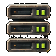
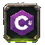
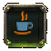
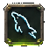
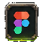
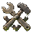

# Hi there , I'm **Carl Matthew T. Castro**

---

## &nbsp; About Me

<!-- Keep the icon column unwrapped so long text does not squeeze icons on mobile. -->
<table>
<thead>
<tr><th width="56"></th><th>Field</th><th>Details</th></tr>
</thead>
<tbody>
<tr>
<td align="center" width="56" nowrap="nowrap"></td>
<td><strong>Age</strong></td>
<td>22</td>
</tr>
<tr>
<td align="center" width="56" nowrap="nowrap"></td>
<td><strong>Currently enrolled at</strong></td>
<td>Laguna State Polytechnic University – Santa Cruz Campus</td>
</tr>
<tr>
<td align="center" width="56" nowrap="nowrap"></td>
<td><strong>Program</strong></td>
<td>Bachelor of Science in Information Technology (BSIT)</td>
</tr>
<tr>
<td align="center" width="56" nowrap="nowrap"></td>
<td><strong>Passionate about</strong></td>
<td>Cybersecurity & Software Development</td>
</tr>
<tr>
<td align="center" width="56" nowrap="nowrap"></td>
<td><strong>Fun fact</strong></td>
<td>I love playing the guitar and I'm a proud fan of <strong>T1 Esports!</strong></td>
</tr>
</tbody>
</table>

---

## &nbsp; Goals

<!-- Keep the icon column unwrapped so long text does not squeeze icons on mobile. -->
<table>
<thead>
<tr><th width="56"></th><th>Goal</th></tr>
</thead>
<tbody>
<tr>
<td align="center" width="56" nowrap="nowrap"></td>
<td>Aiming to strengthen my expertise in <strong>coding, backend/frontend development, and cross-platform application development</strong></td>
</tr>
<tr>
<td align="center" width="56" nowrap="nowrap"></td>
<td>Create <strong>impactful projects</strong> that benefit my community</td>
</tr>
<tr>
<td align="center" width="56" nowrap="nowrap"></td>
<td>Gain expertise in <strong>databases (SQL)</strong> and <strong>full-stack development</strong></td>
</tr>
</tbody>
</table>

---

## &nbsp; Current Projects

<!-- Keep the icon column unwrapped so long text does not squeeze icons on mobile. -->
<table>
<thead>
<tr><th width="56"></th><th>Focus</th></tr>
</thead>
<tbody>
<tr>
<td align="center" width="56" nowrap="nowrap"></td>
<td><a href="https://github.com/carlmatthewcastro/lubosmart-app"><strong>LubosMart</strong></a> — An e-commerce and delivery platform for local communities, built with <strong>Laravel, React, and TypeScript</strong>.</td>
</tr>
<tr>
<td align="center" width="56" nowrap="nowrap"></td>
<td>Developing full-stack web applications using <strong>Laravel</strong>.</td>
</tr>
<tr>
<td align="center" width="56" nowrap="nowrap"></td>
<td>Mastering the <strong>request lifecycle</strong> and client-server architecture.</td>
</tr>
<tr>
<td align="center" width="56" nowrap="nowrap"></td>
<td>Improving <strong>Git</strong> and <strong>GitHub</strong> workflows for source-code management.</td>
</tr>
<tr>
<td align="center" width="56" nowrap="nowrap"></td>
<td>Developing practice projects in Python, C#, and Java.</td>
</tr>
<tr>
<td align="center" width="56" nowrap="nowrap"></td>
<td>Exploring mobile app development with <strong>Flutter</strong> and <strong>Android Studio</strong>.</td>
</tr>
</tbody>
</table>

---

## &nbsp; Recent Milestones

<!-- Keep the icon column unwrapped so long text does not squeeze icons on mobile. -->
<table>
<thead>
<tr><th width="56"></th><th>Milestone</th><th>Details</th></tr>
</thead>
<tbody>
<tr>
<td align="center" width="56" nowrap="nowrap"></td>
<td><strong>Laravel Environment</strong></td>
<td>Successfully configured PHP, Composer, and Laravel, and deployed my first Laravel application.</td>
</tr>
<tr>
<td align="center" width="56" nowrap="nowrap"></td>
<td><strong>Web Architecture</strong></td>
<td>Gained a deep understanding of the request lifecycle and how backend frameworks facilitate server-client communication.</td>
</tr>
<tr>
<td align="center" width="56" nowrap="nowrap"></td>
<td><strong>Version Control</strong></td>
<td>Strengthened collaborative skills and source-code management practices.</td>
</tr>
</tbody>
</table>

---

## &nbsp; Languages & Tools

---

## &nbsp; Skills

<!-- Keep the icon column unwrapped so long text does not squeeze icons on mobile. -->
<table>
<thead>
<tr><th width="56"></th><th>Category</th><th>Stack</th></tr>
</thead>
<tbody>
<tr>
<td align="center" width="56" nowrap="nowrap"></td>
<td><strong>Web Development</strong></td>
<td>Laravel, PHP, HTML, CSS, JS</td>
</tr>
<tr>
<td align="center" width="56" nowrap="nowrap"></td>
<td><strong>Programming</strong></td>
<td>Python, Java, C#</td>
</tr>
<tr>
<td align="center" width="56" nowrap="nowrap"></td>
<td><strong>Database & Tools</strong></td>
<td>MySQL, Git, GitHub</td>
</tr>
</tbody>
</table>

 

## Socials

---

*✨ Always eager to explore and learn new technologies ✨*

